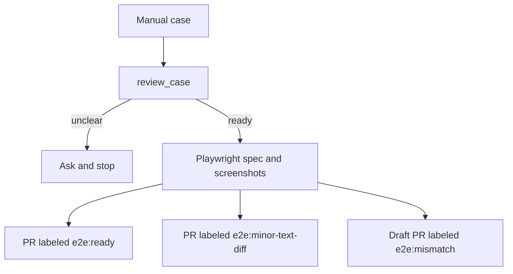

<!--suppress HtmlDeprecatedAttribute -->
<div align="center">
  
  <h1>e2e-qa-pilot</h1>
  <p><em>Turn manual test cases into reviewed, automated Playwright PRs.</em></p>
  <p>
    <a href="LICENSE"></a>
    
    
    
  </p>
</div>

[**Get started**](#get-started) · [**Examples**](https://github.com/bogdanOwner/e2e-qa-pilot/blob/main/examples/boutique-cabin/README.md) · [**MCP**](mcp.md) · [**Docs**](docs/README.md) · [**Contributing**](CONTRIBUTING.md)

e2e-qa-pilot gives your coding agent the expected result up front, so it can build the test, verify it with screenshots, and open a PR you can review in minutes.

## Why a pilot

- It asks once, up front, and only when the case is unclear. It does not invent an expected result.
- It checks the final screen. The pull request shows every step and a screenshot.
- A person reviews the pull request. Nothing is auto-merged.

## See it work

One chat line on the Cabana example. The label says what happened. The link opens the pull request for that case.

| You send | You get | PR example |
|----------|---------|------------|
| A case where every step matches | `e2e:ready`. Behavior matches, with screenshots | [PR for cases/ready.md](https://github.com/bogdanOwner/e2e-qa-pilot/pull/3) |
| The same case, one sentence off | `e2e:minor-text-diff`. A wording difference does not stop the flow | [PR for cases/wording.md](https://github.com/bogdanOwner/e2e-qa-pilot/pull/4) |
| A case that hits a real bug | Draft `e2e:mismatch`. The failed step and the screen | [PR for cases/mismatch.md](https://github.com/bogdanOwner/e2e-qa-pilot/pull/5) |
| A case with no expected result | No spec and no pull request. The assistant asks what should be visible | No pull request |

The prompts and the case text are in the [Cabana example](https://github.com/bogdanOwner/e2e-qa-pilot/blob/main/examples/boutique-cabin/README.md).

## Choose your process

These are independent entry points.

| What you need | Process | Outcome |
|---------------|---------|---------|
| Build end-to-end coverage from a manual case or a short description | [Create e2e](processes/create-e2e/README.md) | A pull request labeled `e2e:ready`, `e2e:minor-text-diff`, or draft `e2e:mismatch`, with screenshots and a step table |
| Explain a failing nightly run and open one fix for review | Nightly AutoFix, not implemented, coming soon. [Planned flow](processes/autofix-nightly/README.md) | Read the frontend changes since the last run, rerun the failed tests to check for flakiness, report why it failed, and open a fix pull request |

## Labels at a glance

| Label | What to do |
|-------|------------|
| `e2e:ready` | Review and merge. Function and screenshots match |
| `e2e:minor-text-diff` | Decide on the wording. The flow was not stopped, and the exact sentence was not marked as a pass |
| `e2e:mismatch` | Look at the bug. Draft pull request. This is a finding, not an automatic verdict |

## How it works



Because the expected result is known up front, the agent keeps working until there is a pull request. It does not stop at the first red run.

- **A page description comes first.** From the case, or from Figma when a link is present, the agent writes what each screen should show. That makes a quick fix easier when only a CSS or copy difference is left.
- **It compares the real screenshot with that description.** That is how it tells a wording difference from a real bug, and labels the pull request to match.
- **The loop is bounded.** A spec gets at most five runs, and a real behavior difference stops the run at once, so it does not loop forever.
- **The case can live elsewhere.** Paste it, or pass an id and let your case-tool MCP (Qase, TestRail, Xray, and so on) supply the ticket text. A design tool such as Figma is optional and adds design detail.
- **The page descriptions will also help a nightly fix process.** That process is not implemented, coming soon.

The full diagram is in [Install](docs/install.md#how-a-run-ends). Tool contracts are in [mcp.md](mcp.md).

## Configuration

Two files, both created once by `init`. `.e2e-qa-pilot/settings.md` holds the keys every project shares. `.e2e-qa-pilot/project.md` holds what only your repository has: ticket id, branch and commit format, case tool, Figma, feature flags, and read-only context repositories ([Project file](docs/project.md)). These settings matter most.

| Setting | Options | What it changes |
|---------|---------|-----------------|
| `pr_mode` | `create_pr_for_review` (default), `ask_before_pr` | Whether a bug opens a draft pull request on its own, or the agent stops and asks first. Nothing is auto-merged either way |
| `figma` | `on`, `off` | `on` with a figma.com link in the case compares each screen with its frame. `off` uses the case steps as the oracle |
| Case source | pasted text, or a case id | A case id needs a connected case-tool MCP and a `## Case tool` section in `project.md`. The update step was written against Qase. Other case tools should work through their own MCP, but are not tested here |
| `test_command`, `png_dir` | your Playwright command, a folder | How the spec is run, and where screenshots go |
| `pr_label_ready`, `pr_label_minor_text_diff`, `pr_label_mismatch` | label names | Rename the three labels |

All keys, defaults, and the label rules are in [Settings](docs/settings.md). Do not store tokens in the file.

## Get started

You need Node 22 or later, plus Cursor or Claude Code. The four tools are `review_case`, `add_from_steps`, `add_from_design`, and `setup_project`. They return instructions, and your assistant does the work. The default branch name comes from the case title (`{title_slug}`), or `e2e/{case_id}-{title_slug}` for a case id. `.e2e-qa-pilot/project.md` can replace that name, the commit subject, and the pull-request base. The fallback base is `main`.

```bash
npx e2e-qa-pilot init
```

`init` writes `.e2e-qa-pilot/settings.md` (the keys every project shares), `.e2e-qa-pilot/project.md` (what is specific to your repository), a copy of the Create e2e commands under `.e2e-qa-pilot/processes/create-e2e/`, editor skill stubs, an always-on instruction (a Cursor rule, or a block in `CLAUDE.md`), and an MCP entry. Those files, and `.e2e-qa-pilot/manifest.json` (the version record that `upgrade` uses), start untracked. Review and commit them before a run that creates or switches a branch. A case review can run while they are still untracked. The branch step stops until they are committed. It does not stash or delete them.

Restart the editor and open a new chat. Tell the assistant about your project once. It checks the repository and the connected tools, and asks one batch of questions for the rest:

```text
Set up e2e-qa-pilot for this project.
```

Then send one line per case. A pasted case needs a `Title:` line. A case id needs your case tool connected.

```text
Review case QA-123, then implement it with e2e-qa-pilot.
```

- [Install and init](docs/install.md) for prerequisites, the steps for Cursor and for Claude Code, what `init` writes, and `upgrade`.
- [Project file](docs/project.md) for the ticket tracker, branch format, case tool, design tool, feature flags, and a frontend repository, with two copy-paste examples (Jira, Plane).
- [Settings](docs/settings.md) for the test command, labels, and `pr_mode`.
- [MCP](mcp.md) for the tools, and [without MCP](mcp.md#without-mcp) if you only want the Markdown skills.
- [Example](https://github.com/bogdanOwner/e2e-qa-pilot/blob/main/examples/boutique-cabin/README.md) to try the four cases.
- [Scope and trust](docs/scope-and-trust.md) for what this package does and does not do.

## Community

[Contributing](CONTRIBUTING.md) · [Security](SECURITY.md) · [Code of conduct](CODE_OF_CONDUCT.md) · [MIT](LICENSE)
