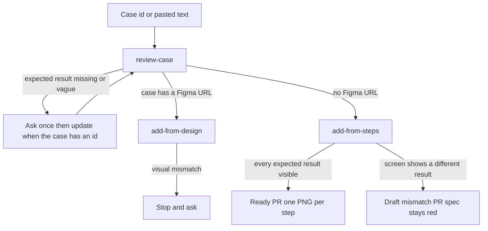

# e2e-qa-pilot

An AI-driven MCP server and visual Story Kit that accelerates test authoring from specifications, slashes maintenance overhead via self-healing, and enforces human-in-the-loop control.


You have a manual test case: an id in the case tool you configure, such as Qase, or the full case text pasted into chat. You already use Cursor or Claude Code. e2e-qa-pilot turns that case into a Playwright spec and a pull request, and it stops to ask you when the case is vague.

## Quick start

In your own project:

```bash
npm install -g e2e-qa-pilot     # or skip this and use npx
cd my-project
e2e-qa-pilot init
```

With `npx` and no install: `npx e2e-qa-pilot init`.

Restart Cursor or Claude Code, then ask in the chat:

```text
Review case QA-123, then implement it with e2e-qa-pilot.
```

Or paste the full case and ask to review it. No case tool is required for pasted text.

`init` works on the folder you are in. It looks for `.cursor/` and `.claude/`, sets up the one it finds, and sets up both when both folders are present or when neither is. To choose, pass `--integration cursor`, `--integration claude`, or `--integration all`.

### What `init` writes

| File | Purpose |
|------|---------|
| `.e2e-qa-pilot/settings.md` | Your case tool, test command, PNG folder, and PR labels. Created once, never overwritten |
| `.e2e-qa-pilot/processes/create-e2e/` | The three commands and shared rules, as plain Markdown |
| `.cursor/skills/<name>/SKILL.md` | Cursor skills (`review-case`, `add-from-steps`, `add-from-design`) |
| `.claude/skills/<name>/SKILL.md` | The same skills for Claude Code |
| `.cursor/mcp.json` and `.mcp.json` | One `e2e-qa-pilot` entry. Other servers in the file are kept. An entry that is already listed stays as it is |

Run `init` again at any time. It leaves existing files alone. `--force` refreshes a file only when that file still has the exact `<!-- e2e-qa-pilot:managed -->` line. `.e2e-qa-pilot/settings.md` and an MCP entry that is already listed stay as they are.

### Prefer to copy the files yourself

Nothing here is hidden. The skills are Markdown. Copy [processes/create-e2e/commands/](processes/create-e2e/commands/) into your project, point a skill at each `SKILL.md`, and skip the install and the MCP server completely. Read every line before you give it access to anything.

## How it works

You keep your own case tool and its MCP server when you pass a case id (for example Qase). Pasted case text does not need one. e2e-qa-pilot adds three tools that tell the assistant exactly how to do the job. The server fetches nothing and holds no token. The assistant uses your case tool, Playwright, and GitHub.



| Tool | What it hands the assistant |
|------|-----------------------------|
| `review_case` | Check the case from a case id or pasted text, ask one question per hole, update that same case when it came from an id, then route |
| `add_from_steps` | No Figma link. The steps are the oracle. Write the spec and open a pull request |
| `add_from_design` | A `figma.com` link and `figma: on`. Compare each milestone with its frame |

Example input, a manual case:

```text
Pre-conditions: the user is logged in and can open the Personal Space page.
1. Open the Personal Space page.        Expected: the Mood Diary component is displayed.
2. Click the Awesome mood emoji.        Expected: the Create Diary Entry modal opens with Awesome preselected.
...
8. Enter the thoughts text and click Save.
   Expected: a success toast appears, the modal closes, and the new entry shows in the Mood Diary preview.
```

Output: a Playwright spec that asserts every expected result, one PNG per proved step, and a pull request. If an expected result is missing or vague, the assistant asks you first. It never invents one.

More detail, and what the assistant still does itself, is in [mcp.md](mcp.md).

## Choose your process

These are independent entry points, not phases.

| What you need | Process | Outcome |
|---------------|---------|---------|
| Author end-to-end coverage from an existing case | [Create e2e](processes/create-e2e/README.md) | A case a human clarified, a spec that asserts every expected result, one PNG per proved step, and a pull request |
| Explain a red nightly and open one pull request | [AutoFix nightly](processes/autofix-nightly/README.md) | Later. This phase does not include it |

## Settings

The first `review-case` run reads `.e2e-qa-pilot/settings.md`. If a key this input needs is empty, the assistant asks once in chat and writes your answers into that file. A case id needs `case_tool`, `fetch_case`, and `update_case`. Pasted case text does not. Do not paste a secret into the chat. Put how to fetch and update a case in the settings file, and keep tokens in your own MCP configuration.

| Key | Meaning |
|-----|---------|
| `case_tool`, `fetch_case`, `update_case` | Where cases live and how to read and update one. Used only for a case id |
| `figma`, `read_figma` | `on` or `off`, and how to read a frame |
| `branch_pattern`, `test_command`, `png_dir` | How to name the branch, run the spec, and where PNGs go |
| `pr_label_ready`, `pr_label_mismatch` | Labels for a ready and a draft-mismatch pull request |

## Scope

- Playwright only. The commands describe Playwright specs, runs, and screenshots. Selenium is not supported.
- Any case tool that your assistant can read and update through its own MCP server, or no case tool when you paste the case. Qase is the worked example. This server does not implement a case-tool client.
- A person decides. The assistant asks when a step is vague, reads every screenshot, and stops on a visual difference before it opens a pull request.

## Trust

This tool is MIT licensed and small on purpose. The MCP server is [src/mcp.mjs](src/mcp.mjs) with shared constants in [src/kit.mjs](src/kit.mjs), and it has no dependencies. It reads no network and no token, and it does not contact a case tool. Case text in a tool call is the text the client sent. `init` is [src/init.mjs](src/init.mjs) and uses those same constants. Secrets stay in your own MCP configuration and CI secrets. They are never written to a commit, a report, or a pull request.

## Contributing

```bash
npm test
```

Open an issue before a large change. The commands in [processes/create-e2e/commands/](processes/create-e2e/commands/) are the spec, so a behavior change starts there.

## License

[MIT](LICENSE)
