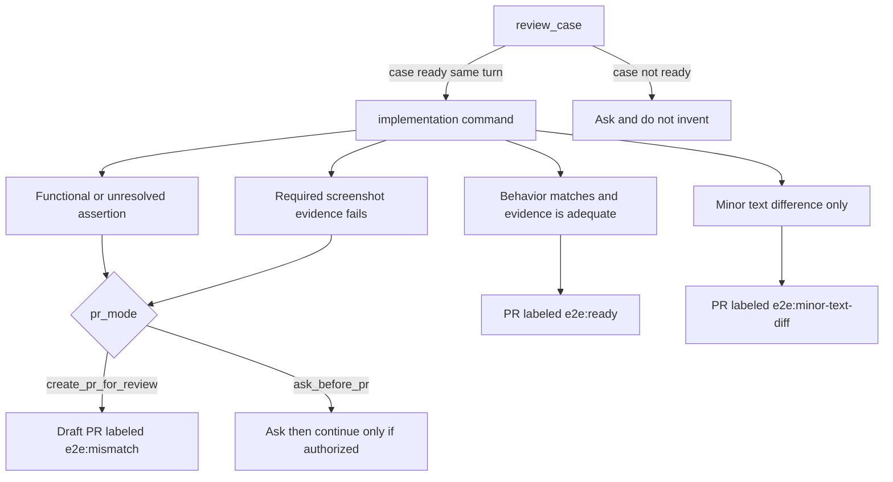

# e2e-qa-pilot

e2e-qa-pilot is a small MCP server and a set of Markdown commands for Cursor and Claude Code. You provide one manual test case, either as an ID from an externally configured case-tool MCP or as pasted text. The server returns workflow instructions and your settings. It does not fetch cases, run Playwright, or create pull requests. Your assistant is instructed to review the case for clear, testable expectations, implement a Playwright spec, collect screenshot evidence, document the results, and open a pull request for human QA review when the necessary tools and permissions are available.

The default `pr_mode` is `create_pr_for_review`. It allows the assistant to create a pull request for review without auto-merging it. The optional `ask_before_pr` mode requires the assistant to stop and ask before creating a pull request when a functional mismatch, unresolved discrepancy, or failed final-screenshot gate remains. If the discrepancy remains after clarification, the assistant must obtain explicit authorization before creating the pull request.

Pull requests use three outcome labels: `e2e:ready` for matching functional behavior and sufficient evidence, `e2e:minor-text-diff` for matching functional behavior with a narrowly classified and documented wording difference, and `e2e:mismatch` for functional or unresolved discrepancies or inadequate required screenshot evidence. Assertion results and screenshot findings are reported separately. A minor wording difference is documented in the results table and PR comments. It is not treated as a passed exact-text assertion, and the expected text is not rewritten to make the test pass.

The repository's tests check the consistency of these instructions and documentation. They do not prove that an assistant will follow the workflow correctly.


## What the package does

`init` copies Markdown commands and editor stubs into a project. `mcp` serves three tools over stdio: `review_case`, `add_from_steps`, and `add_from_design`. Each tool returns instruction text and your settings file. The flowchart below is the workflow those instructions ask the assistant to follow. The server does not read or enforce `pr_mode`, and it does not choose a label.



| Tool | What it hands the assistant |
|------|-----------------------------|
| `review_case` | Check the case from a case id or pasted text, ask one question per hole, update that same case when it came from an id, then route. The server does not write a spec. A ready case continues into the next command in the same turn |
| `add_from_steps` | No `figma.com` URL, or `figma: off`. The steps are the oracle. Write the spec and open a pull request |
| `add_from_design` | A `figma.com` link and `figma: on`. Compare each milestone with its frame |

The same diagram is in [Create e2e](processes/create-e2e/README.md). Tool contracts are in [mcp.md](mcp.md).

## Pull request outcomes

When the assistant has the tools and permissions the commands name, the intended deliverables are a Playwright spec, a step-by-step results table, screenshot evidence, pull request comments, and a pull request for human QA review. A label is a review outcome. It does not mean the change is approved or merged.

A green test run means only that the assertions executed by that run passed. It does not prove that every expected behavior was tested or that the screenshots demonstrate every required state. A failed assertion and inadequate screenshot evidence are separate findings. Inadequate screenshot evidence does not, by itself, prove that a functional assertion failed.

- `e2e:ready` — functional assertions passed, the expected behavior matches, and all required screenshot evidence meets the acceptance criteria.
- `e2e:minor-text-diff` — functional behavior matches, and the only discrepancy is a minor wording difference that meets the documented classification rule. The difference is explicitly recorded. It is not reported as a passed exact-text assertion.
- `e2e:mismatch` — a functional mismatch or unresolved discrepancy exists, or required screenshot evidence fails to demonstrate the expected end state. The pull request is a draft. It is not a confirmed product regression.

Nothing is auto-merged.

## Prerequisites

- Node 22 or later.
- Playwright must already be configured, including a browser install. The commands never install browsers.
- An assistant that can read and edit the repository, run the test command, and read screenshots. It needs enough project context for the workflow you use.
- Git access to `origin`, with `main` as the base branch. The commands branch from `main` and target it.
- Optional: a case-tool MCP, only when you pass a case id. Qase is the worked example. The update checklist is Qase-shaped and has not been verified against other integrations.
- Optional: Figma access from your assistant, only for design comparison. That path can depend on a milestone screenshot helper in your project. This package does not provide one.
- Optional: GitHub access to create a pull request and apply labels. `init` does not configure any of these integrations.

## Quick start

The worked example is a small site in a clone of this repository. The published npm package does not include `examples/boutique-cabin`. Start the page, then send one chat line that names a case file. The four lines cover two successful confirmations, a wording difference, and a case with no expected result.

```bash
cd examples/boutique-cabin
npm install
npm start
```

That serves the page at `http://127.0.0.1:4173`. Install Chromium once before an assistant run (`npx playwright install chromium`). The workflow commands will not do this. The four one-line reviews are in `examples/boutique-cabin/README.md`.

In your own project:

```bash
npm install -g e2e-qa-pilot     # or skip this and use npx
cd my-project
e2e-qa-pilot init
```

With `npx` and no install: `npx e2e-qa-pilot init`.

Restart Cursor or Claude Code, then ask in the chat. A pasted case needs no case tool. A case id needs one.

**A pasted case.** Include a `Title:` line, or the assistant will ask for one.

```text
Review this case with e2e-qa-pilot and implement it if it is ready:

Title: Book Chalet 4 at Cabana
Preconditions: the guest is on the Cabana page.
1. Set check-in to 4 Aug 2026 and check-out to 5 Aug 2026, then click Search.
   Expected: Chalet 4 is listed at 497 EUR.
2. Press Increase quantity on the 497 EUR rate, click Reserve Now, enter the guest details, and click Confirm Booking.
   Expected: the confirmation says "Your request was successfully sent." and a booking reference is shown.
```

Pasted text needs no case tool, but the first run still asks once for the settings that generating a spec needs, such as `test_command` and `png_dir` (see [Settings](#settings)). `pr_mode` and the label keys have defaults, so an empty value is not a question. If the case is ready, `review_case` carries on into the matching command in the same turn, and that can end in a pull request when GitHub access exists. The instructions do not define a review-only mode. Details are in [mcp.md](mcp.md#review_case).

**A case id.** Connect your case tool first (for example Qase).

```text
Review case QA-123, then implement it with e2e-qa-pilot.
```

`init` works on the folder you are in, or on a path you pass: `e2e-qa-pilot init [path]`. It looks for `.cursor/` and `.claude/`, sets up the one it finds, and sets up both when both folders are present or when neither is. To choose, pass `--integration cursor`, `--integration claude`, or `--integration all`. Cursor and Claude Code are the two editors `init` knows how to set up. See [mcp.md](mcp.md#what-is-and-is-not-verified) for what has been verified.

### What `init` writes

| File | Purpose |
|------|---------|
| `.e2e-qa-pilot/settings.md` | Your case tool, test command, PNG folder, `pr_mode`, and PR labels. Created once, never overwritten |
| `.e2e-qa-pilot/processes/create-e2e/` | A copy of the Create e2e folder: the three commands, the shared rules, and a short README, as plain Markdown |
| `.cursor/skills/<name>/SKILL.md` | Cursor skills (`review-case`, `add-from-steps`, `add-from-design`). Each is a short stub that points at the commands above |
| `.claude/skills/<name>/SKILL.md` | The same skills for Claude Code |
| `.cursor/mcp.json` and `.mcp.json` | One `e2e-qa-pilot` entry. Other servers in the file are kept. An entry that is already listed stays as it is |

Run `init` again at any time. It leaves existing files alone.

- `--force` refreshes a file only when that file still has the exact `<!-- e2e-qa-pilot:managed -->` line. **That replaces any edits you made to such a file.** Remove the line from a file to keep it as yours.
- `.e2e-qa-pilot/settings.md` and an MCP entry that is already listed are never changed, even with `--force`.
- An MCP file that is not valid JSON, or does not have the expected shape, is left alone, and `init` prints the entry to add by hand.

## Settings

The first `review-case` run reads `.e2e-qa-pilot/settings.md`. If a key it needs is empty, the assistant asks once in chat and writes your answers into that file. A case id needs `case_tool`, `fetch_case`, and `update_case`. Pasted case text does not. Both inputs need `figma`, `read_figma`, `branch_pattern`, `test_command`, and `png_dir`.

The settings file is included in every tool result, so do not store tokens in it. Put how to fetch and update a case in the file, and keep tokens in your own MCP configuration. Do not paste a secret into the chat.

| Key | Meaning |
|-----|---------|
| `case_tool`, `fetch_case`, `update_case` | Where cases live and how to read and update one. Used only for a case id |
| `figma`, `read_figma` | `on` or `off`, and how to read a frame |
| `branch_pattern`, `test_command`, `png_dir` | How to name the branch, run the spec, and where PNGs go |
| `pr_mode` | `create_pr_for_review` (default) or `ask_before_pr`. A missing value means `create_pr_for_review` |
| `pr_label_ready` | Label when behavior matches and required screenshot evidence is adequate. Default `e2e:ready` |
| `pr_label_minor_text_diff` | Label when the only issue is a narrow wording difference. Default `e2e:minor-text-diff` |
| `pr_label_mismatch` | Label for a functional or unresolved mismatch, or inadequate required screenshot evidence. Default `e2e:mismatch` |

The command files list `read_figma` among the required keys even when `figma: off`. The settings template leaves it blank in that case. Until that is settled, expect to be asked for it once. Changing that behavior is outside the current instructions. See [Known limitations](mcp.md#known-limitations).

## Required inputs and reference conventions

The server requires exactly one of `case_id` or `case_text`. Pasted text needs no case tool. A case id needs `case_tool`, `fetch_case`, `update_case`, and an external case-tool MCP. Generating a spec needs `figma`, `read_figma`, `branch_pattern`, `test_command`, and `png_dir`. `pr_mode`, `pr_label_ready`, `pr_label_minor_text_diff`, and `pr_label_mismatch` have defaults, so a missing value is not a question.

Reference conventions in the commands, which another project may adapt, include `overview.md`, Gherkin under `specs/`, page contracts under `pages/`, page objects, flows, and a Playwright fixture. There is no settings key for those paths. A project does not have to copy that layout for the server to start. `examples/boutique-cabin` uses it so the reference workflow can be read in one place. That directory is in this git repository and is not part of the published package. Figma helpers such as `attachMilestoneScreenshot` are not in the example and are not provided by this package.

## Scope

- Playwright only. The commands describe Playwright specs, runs, and screenshots. Selenium is not supported.
- Case tools: Qase is the worked example, and the `review-case` command describes how it updates a Qase case. Other tools may work if your assistant can read and update them through its own MCP server, but none are tested or officially supported here. This package does not implement a case-tool client. Pasted case text needs none.
- A person decides when a requirement is ambiguous. The assistant is told to ask and not to invent an expected result. `ask_before_pr` also stops for a functional mismatch, an unresolved difference, or a failed final-screenshot gate. A narrow minor text difference does not trigger that stop.

**Create e2e is implemented.** The three tools hand your assistant those instructions. While writing the spec, the assistant may adjust locators or waits in that spec. **AutoFix nightly is not implemented.** There are no commands, tools, or install step for it. See [AutoFix nightly](processes/autofix-nightly/README.md).

## Trust

This tool is MIT licensed and small on purpose. The MCP server is [src/mcp.mjs](src/mcp.mjs) with shared constants in [src/kit.mjs](src/kit.mjs). It has no dependencies, makes no network requests, and only reads the packaged command files and your `.e2e-qa-pilot/settings.md`. It writes only JSON-RPC to stdout. Case text in a tool call is the text the client sent. `init` is [src/init.mjs](src/init.mjs) and uses the same constants.

This project does not store credentials. What your assistant commits, reports, or posts to a pull request is outside this project's control, so review the diff and the pull request yourself. The `npx` entry that `init` writes downloads the package from npm when it starts, which is separate from the server's own behavior.

## Contributing

```bash
npm test
```

`npm test` runs behavioral tests of `init` and the MCP server, and documentation consistency checks in `test/docs.test.mjs`. They check that instruction text and documentation match the code. They do not prove that an assistant follows the instructions, they do not validate the assistant workflow end to end, and they do not run Cursor or Claude Code.

Open an issue before a large change. The commands in [processes/create-e2e/commands/](processes/create-e2e/commands/) are the spec, so a behavior change starts there.

## License

[MIT](LICENSE)
