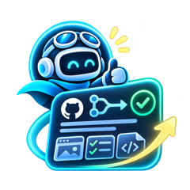
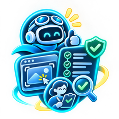
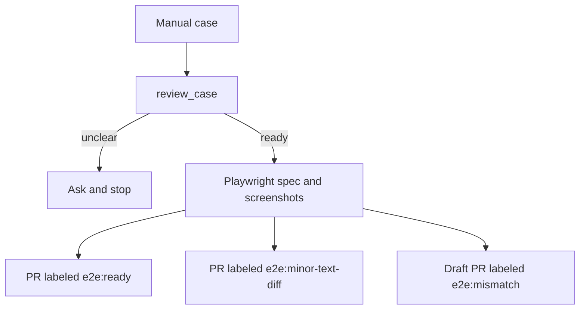

<!--suppress HtmlDeprecatedAttribute -->
<div align="center">
  <h1>e2e-qa-pilot</h1>
  <p><em>Turn manual test cases into reviewed, automated Playwright PRs.</em></p>
  <p>
    <a href="https://www.npmjs.com/package/e2e-qa-pilot"></a>
    <a href="LICENSE"></a>
    
    
    
  </p>
  
</div>

[**Try it**](#try-it-first-a-demo-site-in-this-repository) · [**Install**](#use-it-in-your-project) · [**Examples**](https://github.com/bogdanOwner/e2e-qa-pilot/blob/main/examples/boutique-cabin/README.md) · [**MCP**](mcp.md) · [**Docs**](docs/README.md) · [**Contributing**](CONTRIBUTING.md)

## Why e2e-qa-pilot?

<table>
  <tr>
    <td width="74" valign="middle"></td>
    <td valign="middle"><strong>A PR with evidence, not just code.</strong><br>Every PR includes a Playwright test, step-by-step expected vs. actual results, and screenshots for review.</td>
  </tr>
  <tr>
    <td width="74" valign="middle"></td>
    <td valign="middle"><strong>A green test isn't the finish line.</strong><br>The agent compares actual behavior with the test case's expected results. If expectations are unclear, it asks instead of guessing.</td>
  </tr>
  <tr>
    <td width="74" valign="middle"></td>
    <td valign="middle"><strong>Describe pages once. Reuse across cases.</strong><br>Page descriptions, page objects, and test helpers stay in your repository, ready to support future test cases.</td>
  </tr>
  <tr>
    <td width="74" valign="middle"></td>
    <td valign="middle"><strong>Nothing is auto-merged. Humans decide.</strong><br>The agent prepares the PR and highlights differences. A person reviews the evidence and decides whether to merge.</td>
  </tr>
</table>

## See it work

One chat line on the [Cabana example](https://github.com/bogdanOwner/e2e-qa-pilot/blob/main/examples/boutique-cabin/README.md), which has the prompts and the case text. Each pull request shows the case, the generated spec, a step table, and a screenshot per step. The label tells you what to do next.

| You send | You get | You do |
|----------|---------|--------|
| A case where every step matches | <br>Behavior and screenshots match. [PR #3](https://github.com/bogdanOwner/e2e-qa-pilot/pull/3) | Check the screenshots, then merge |
| The same case, one sentence off | <br>The flow works. The case sentence is shown next to the screen sentence. [PR #4](https://github.com/bogdanOwner/e2e-qa-pilot/pull/4) | Decide: fix the copy or the case |
| A case that hits a real bug | <br>Draft. The failed step, what was expected, and the screen. [PR #5](https://github.com/bogdanOwner/e2e-qa-pilot/pull/5) | Judge the finding. It is not an automatic verdict |
| A case with no expected result | No spec and no pull request. The assistant asks what should be visible | Answer the question |

The label colors are the same on GitHub. If a label is missing in your repository, the assistant creates it with that color.

## How it works



The full diagram is in [Install](docs/install.md#how-a-run-ends). Tool contracts are in [mcp.md](mcp.md).

## Get started

**You need:**

- Node.js 22 or later
- Cursor or Claude Code
- Your agent connected to GitHub, so it can open pull requests. Install the [`gh` CLI](https://cli.github.com/) and run `gh auth login`

### Try it first: a demo site in this repository

Try it without adding anything to your own project.

- **Cabana** is a small booking site with mock data, included in this repository.
- You run ready-made test cases against it on your machine.
- You get real pull requests in your fork, like the three in [See it work](#see-it-work).

👉 **[Try the example in 5 minutes](https://github.com/bogdanOwner/e2e-qa-pilot/blob/main/examples/boutique-cabin/README.md#quick-start)**

### Use it in your project

Open your Playwright project in Cursor or Claude Code and paste this prompt:

```text
Set up e2e-qa-pilot in this project:
1. Run npx e2e-qa-pilot@latest init and show me its check.
   If a requirement is missing, stop and tell me why and how to fix it.
2. Then follow the setup-project skill that init installed.
```

- The agent asks only what it cannot find in your repository.
- It generates a config file, `.e2e-qa-pilot/project.md`, and shows it to you for review before saving it.
- It never commits and never writes a secret.

👉 **[Install guide](docs/install.md#quick-start)**: step-by-step setup and configuration

The MCP server has four tools: `review_case`, `add_from_steps`, `add_from_design`, and `setup_project`. See [mcp.md](mcp.md).

## Community

[Contributing](CONTRIBUTING.md) · [Security](SECURITY.md) · [Code of conduct](CODE_OF_CONDUCT.md) · [MIT](LICENSE)
