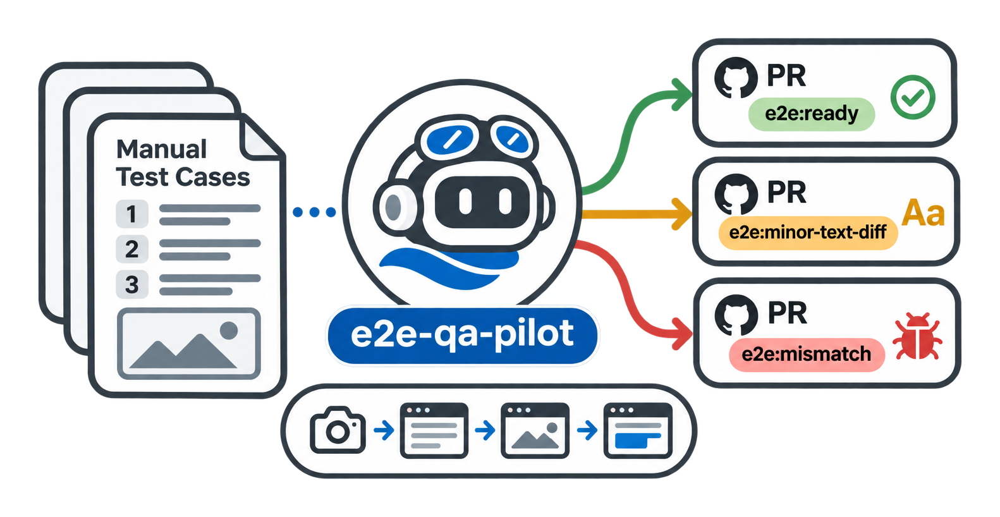
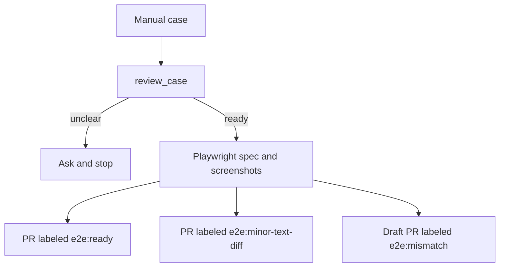

<!--suppress HtmlDeprecatedAttribute -->
<div align="center">
  <h1>e2e-qa-pilot</h1>
  <p><em>Turn manual test cases into reviewed, automated Playwright PRs.</em></p>
  <p>
    <a href="LICENSE"></a>
    
    
    
  </p>
  
</div>

[**Get started**](#get-started) · [**Examples**](https://github.com/bogdanOwner/e2e-qa-pilot/blob/main/examples/boutique-cabin/README.md) · [**MCP**](mcp.md) · [**Docs**](docs/README.md) · [**Contributing**](CONTRIBUTING.md)

## Why e2e-qa-pilot?

<p><strong>A PR with evidence, not just code.</strong><br>Every PR includes a Playwright test, step-by-step expected vs. actual results, and screenshots for review.<br clear="left"></p>

<p><strong>A green test isn't the finish line.</strong><br>The agent compares actual behavior with the test case's expected results. If expectations are unclear, it asks instead of guessing.<br clear="left"></p>

<p><strong>Describe pages once. Reuse across cases.</strong><br>Page descriptions, page objects, and test helpers stay in your repository, ready to support future test cases.<br clear="left"></p>

<p><strong>Nothing is auto-merged. Humans decide.</strong><br>The agent prepares the PR and highlights differences. A person reviews the evidence and decides whether to merge.<br clear="left"></p>

## See it work

One chat line on the [Cabana example](https://github.com/bogdanOwner/e2e-qa-pilot/blob/main/examples/boutique-cabin/README.md), which has the prompts and the case text. Each pull request shows the case, the generated spec, a step table, and a screenshot per step. The label tells you what to do next.

| You send | You get | You do |
|----------|---------|--------|
| A case where every step matches | <br>Behavior and screenshots match. [PR #3](https://github.com/bogdanOwner/e2e-qa-pilot/pull/3) | Check the screenshots, then merge |
| The same case, one sentence off | <br>The flow works. The case sentence is shown next to the screen sentence. [PR #4](https://github.com/bogdanOwner/e2e-qa-pilot/pull/4) | Decide: fix the copy or the case |
| A case that hits a real bug | <br>Draft. The failed step, what was expected, and the screen. [PR #5](https://github.com/bogdanOwner/e2e-qa-pilot/pull/5) | Judge the finding. It is not an automatic verdict |
| A case with no expected result | No spec and no pull request. The assistant asks what should be visible | Answer the question |

The label colors are the same on GitHub. If a label is missing in your repository, the assistant creates it with that color.

## How it works



The full diagram is in [Install](docs/install.md#how-a-run-ends). Tool contracts are in [mcp.md](mcp.md).

## Get started

Requires **Node.js 22+**, an existing Playwright project, and **Cursor or Claude Code**.

**1. Initialize your project**

```bash
npx e2e-qa-pilot init
```

**2. Restart your editor, open a new chat, and send:**

```text
Set up e2e-qa-pilot for this project.
```

The agent checks your project, asks only for missing settings, and writes `.e2e-qa-pilot/project.md` (ticket ids, branch names, case tool). Never put a token there. Credentials stay in your editor's MCP configuration.

**3. Review and commit the generated setup files.**

Do this before the first run that creates a branch.

**4. Send your test case:**

```text
Review case QA-123, then implement it with e2e-qa-pilot.
```

Or paste a case with a `Title:` and expected results for each step. Case IDs require a connected case-tool MCP; pasted cases do not.

[Full installation guide](docs/install.md) · [Project configuration](docs/project.md) · [Settings](docs/settings.md) · [Scope and trust](docs/scope-and-trust.md)

The MCP server exposes four tools: `review_case`, `add_from_steps`, `add_from_design`, and `setup_project`. Contracts are in [mcp.md](mcp.md).

## Community

[Contributing](CONTRIBUTING.md) · [Security](SECURITY.md) · [Code of conduct](CODE_OF_CONDUCT.md) · [MIT](LICENSE)
