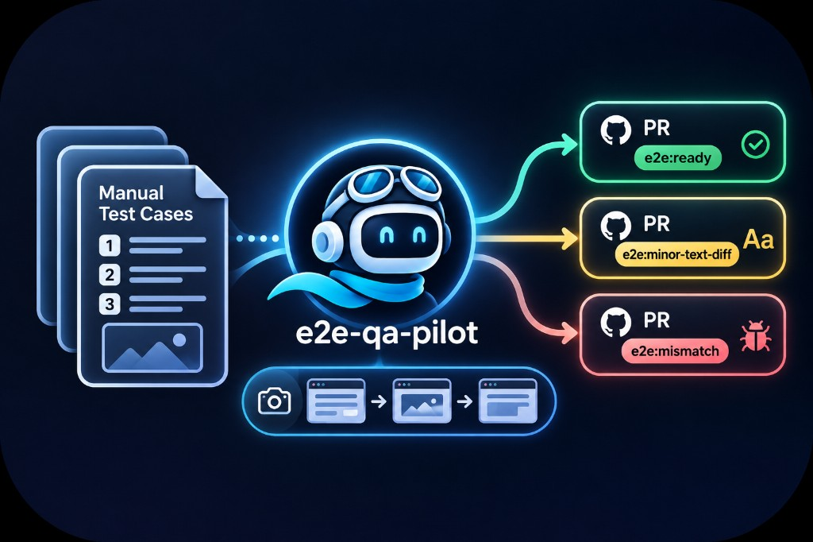
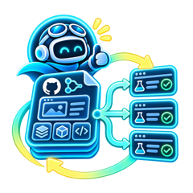
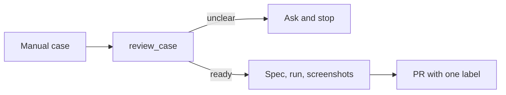

<!--suppress HtmlDeprecatedAttribute -->
<div align="center">
  <h1>e2e-qa-pilot</h1>
  <p><em>Turn manual test cases into reviewed, automated Playwright PRs.</em></p>
  <p>
    <a href="LICENSE"></a>
    
    
    
  </p>
  
</div>

[**Get started**](#get-started) · [**Examples**](https://github.com/bogdanOwner/e2e-qa-pilot/blob/main/examples/boutique-cabin/README.md) · [**MCP**](mcp.md) · [**Docs**](docs/README.md) · [**Contributing**](CONTRIBUTING.md)

## Why e2e-qa-pilot?

<p><strong>A PR with evidence, not just code.</strong><br>Every PR includes a Playwright test, step-by-step expected vs. actual results, and screenshots for review.<br clear="left"></p>

<p><strong>A green test isn't the finish line.</strong><br>The agent compares actual behavior with the test case's expected results. If expectations are unclear, it asks instead of guessing.<br clear="left"></p>

<p><strong>Describe pages once. Reuse across cases.</strong><br>Page descriptions, page objects, and test helpers stay in your repository, ready to support future test cases.<br clear="left"></p>

<p><strong>Nothing is auto-merged. Humans decide.</strong><br>The agent prepares the PR and highlights differences. A person reviews the evidence and decides whether to merge.<br clear="left"></p>

## See it work

One chat line on the Cabana example. Each pull request shows the case, the generated spec, a step table, and a screenshot per step. The label tells you what to do next.

| You send | You get | You do |
|----------|---------|--------|
| A case where every step matches | <br>Behavior and screenshots match. [PR #3](https://github.com/bogdanOwner/e2e-qa-pilot/pull/3) | Check the screenshots, then merge |
| The same case, one sentence off | <br>The flow works. The case sentence is shown next to the screen sentence. [PR #4](https://github.com/bogdanOwner/e2e-qa-pilot/pull/4) | Decide: fix the copy or the case |
| A case that hits a real bug | <br>Draft. The failed step, what was expected, and the screen. [PR #5](https://github.com/bogdanOwner/e2e-qa-pilot/pull/5) | Judge the finding. It is not an automatic verdict |
| A case with no expected result | No spec and no pull request. The assistant asks what should be visible | Answer the question |

The label colors are the same on GitHub. If a label is missing in your repository, the assistant creates it with that color. The prompts and the case text are in the [Cabana example](https://github.com/bogdanOwner/e2e-qa-pilot/blob/main/examples/boutique-cabin/README.md).

## How it works



- **The result is checked on screen, not only by a green test.** A passing run proves only the assertions in that spec. The agent also compares each screenshot with what the step should show, so a test that passes on the wrong screen is not labeled ready.
- **A page description is written first and kept.** From the case, or from Figma, the agent writes what each screen should show: elements and visible copy. In a repository that keeps page contracts (as the Cabana example does under `pages/`), the next case on the same page builds on it instead of starting again. It also makes a copy or CSS difference quick to spot.
- **It never invents an expected result,** and the loop is bounded: at most five runs per spec.

The full diagram is in [Install](docs/install.md#how-a-run-ends). Tool contracts are in [mcp.md](mcp.md).

## Get started

You need Node 22 or later, a git repository with Playwright already set up, and Cursor or Claude Code. The steps are the same for both editors.

1. **Initialize** in your project root:

   ```bash
   npx e2e-qa-pilot init
   ```

   It detects `.cursor/` or `.claude/` and sets up that editor, or both when it finds both or neither.
2. **Restart the editor and open a new chat.** Cursor: reload the window. Claude Code: quit and start it again in this folder.
3. **Set up the project.** In the new chat, send `Set up e2e-qa-pilot for this project.` The assistant reads your repository and asks only about what it could not find. See [Your project file](#your-project-file).
4. **Review and commit** what `init` and setup wrote: `.e2e-qa-pilot/` (check the test command and screenshot folder in `settings.md`), the editor skills, the MCP entry, and the Cursor rule or the `CLAUDE.md` block. Commit before the first run that creates a branch.
5. **Send a case.**
   - **Pasted case:** no integration needed. Include a `Title:` line and an expected result for each step, then ask: `Review this case with e2e-qa-pilot and implement it if it is ready:` followed by the case.
   - **Case ID:** needs your case tool (Qase, TestRail, Xray, and so on) connected as an MCP server, and a `## Case tool` section in `project.md`. Then send `Review case QA-123, then implement it with e2e-qa-pilot.`

More detail: [Install](docs/install.md).

## Your project file

`.e2e-qa-pilot/project.md` says how your repository works: ticket ids, branch names, which case tool, Figma, or flag tool to use, and other repositories to read. You do not write it by hand. Setup looks at your git branches, Playwright config, MCP server names, and `gh` login, asks one batch of questions for the rest, and shows you the file before writing it. Every section is optional.

A filled file can be this short:

```text
## Ticket
Tracker: Jira. Required: yes.

## Branch & commit
Branch: `{ticket_id}_{title_slug}`

## Case tool
Tool: Xray, through the `xray` MCP server.
```

With ticket `PROJ-123` and the case "Login error", the branch is `PROJ-123_login-error`. Never put a token in this file. Credentials stay in your editor's MCP configuration.

More: [Project file](docs/project.md), with two full examples. Test command, labels, and `pr_mode` are in [Settings](docs/settings.md). The four tools are `review_case`, `add_from_steps`, `add_from_design`, and `setup_project` ([MCP](mcp.md)). What this package does and does not do: [Scope and trust](docs/scope-and-trust.md).

## Community

[Contributing](CONTRIBUTING.md) · [Security](SECURITY.md) · [Code of conduct](CODE_OF_CONDUCT.md) · [MIT](LICENSE)
