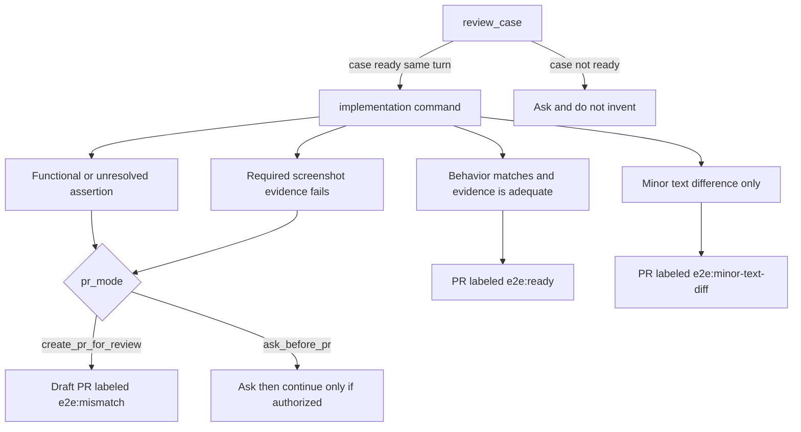

# Install

You need Node 22 or later, Playwright already configured in the project, and Cursor or Claude Code. Playwright's browser install is yours to run. The commands never install browsers.

Git access to `origin` is required for a run that creates or switches a branch. The fallback base is `main`. `## Project rules` can name another starting branch and another pull-request base. Reviewing a case does not need `origin`.

Optional, and only for the path you use:

- A case-tool MCP, when you pass a case id. Qase is the worked example. The update checklist is Qase-shaped and has not been verified against other integrations.
- Figma access from your assistant, only for design comparison. That path can depend on a milestone screenshot helper in your project. This package does not provide one.
- GitHub access to create a pull request and apply labels. `init` does not configure any of these integrations.

## Quick start

In your own project:

```bash
npm install -g e2e-qa-pilot     # or skip this and use npx
cd my-project
e2e-qa-pilot init
```

With `npx` and no install: `npx e2e-qa-pilot init`.

`init` works on the folder you are in, or on a path you pass: `e2e-qa-pilot init [path]`. It looks for `.cursor/` and `.claude/`, sets up the one it finds, and sets up both when both folders are present or when neither is. To choose, pass `--integration cursor`, `--integration claude`, or `--integration all`. Cursor and Claude Code are the two editors `init` knows how to set up. See [What is and is not verified](../mcp.md#what-is-and-is-not-verified).

Restart Cursor or Claude Code, then open a new chat. A chat that was already open does not have the server.

## What `init` writes

| File | Purpose |
|------|---------|
| `.e2e-qa-pilot/settings.md` | Your case tool, test command, PNG folder, `pr_mode`, and PR labels. Created once, never overwritten |
| `.e2e-qa-pilot/processes/create-e2e/` | A copy of the Create e2e folder: the three commands, the shared rules, and a short README, as plain Markdown |
| `.cursor/skills/<name>/SKILL.md` | Cursor skills (`review-case`, `add-from-steps`, `add-from-design`). Each is a short stub that points at the commands above |
| `.claude/skills/<name>/SKILL.md` | The same skills for Claude Code |
| `.cursor/mcp.json` and `.mcp.json` | One `e2e-qa-pilot` entry. Other servers in the file are kept. An entry that is already listed stays as it is |

Those files are untracked until you commit them. Review the diff and commit it before a workflow that creates or switches a branch. Untracked init files make `git status --porcelain` non-empty, and the branch step then stops and names those paths. It does not stash, reset, or delete them. Reviewing a case does not need a clean tree or `origin`.

## Upgrade

Run `init` again at any time. It leaves existing files alone.

- `--force` refreshes a file only when that file still has the exact `<!-- e2e-qa-pilot:managed -->` line. **That replaces any edits you made to such a file.** Remove the line from a file to keep it as yours.
- `.e2e-qa-pilot/settings.md` and an MCP entry that is already listed are never changed, even with `--force`.
- An MCP file that is not valid JSON, or does not have the expected shape, is left alone, and `init` prints the entry to add by hand.

The skills also work without the MCP entry. See [Without MCP](../mcp.md#without-mcp).

## Ask in one line

A pasted case needs no case tool. Include a `Title:` line, or the assistant will ask for one.

```text
Review this case with e2e-qa-pilot and implement it if it is ready:

Title: Book Chalet 4 at Cabana
Preconditions: the guest is on the Cabana page.
1. Set check-in to 4 Aug 2026 and check-out to 5 Aug 2026, then click Search.
   Expected: Chalet 4 is listed at 497 EUR.
2. Press Increase quantity on the 497 EUR rate, then click Reserve Now.
   Expected: the guest form opens on the confirm page.
3. Enter First Name "Ana", Last Name "Pop", and Email Address "ana.pop@example.com", accept the terms, and click Confirm Booking.
   Expected: the confirmation says "Your request was successfully sent." and a booking reference is shown.
```

Pasted text needs no case tool, but the first run still asks once for the settings that generating a spec needs, such as `test_command` and `png_dir`. See [Settings](settings.md). `pr_mode` and the label keys have defaults, so an empty value is not a question. If the case is ready, `review_case` carries on into the matching command in the same turn, and that can end in a pull request when GitHub access exists. The instructions do not define a review-only mode. Details are in [mcp.md](../mcp.md#review_case).

A case id needs a connected case tool (for example Qase):

```text
Review case QA-123, then implement it with e2e-qa-pilot.
```

## Worked example

This repository includes an example you can use to see e2e-qa-pilot run. The pull requests from that run are linked there, and the same page explains how to run it locally.

[examples/boutique-cabin/README.md](https://github.com/bogdanOwner/e2e-qa-pilot/blob/main/examples/boutique-cabin/README.md)

That folder is in the git repository. The published npm package does not include it.

## How a run ends

`init` copies Markdown commands and editor stubs into a project. `mcp` serves three tools over stdio: `review_case`, `add_from_steps`, and `add_from_design`. Each tool returns instruction text and your settings file. The flowchart is the workflow those instructions ask the assistant to follow. The server does not read or enforce `pr_mode`, and it does not choose a label. The same diagram is in [Create e2e](../processes/create-e2e/README.md). Tool contracts are in [mcp.md](../mcp.md).


