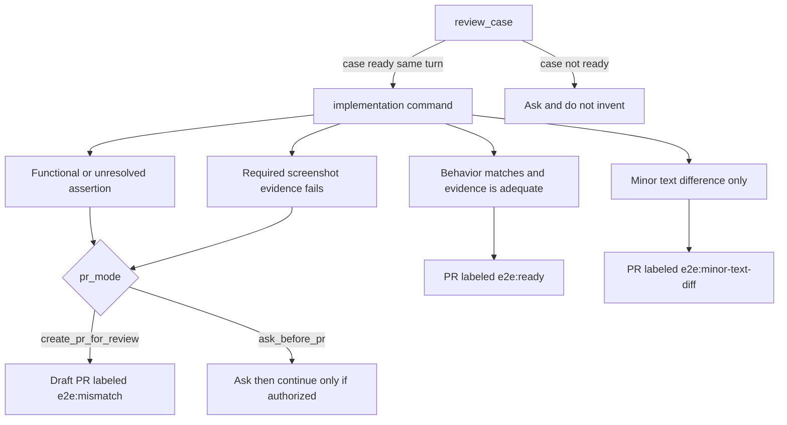

# Install

You need Node 22 or later, Playwright already configured in the project, and Cursor or Claude Code. Playwright's browser install is yours to run. The commands never install browsers.

Git access to `origin` is required for a run that creates or switches a branch. The fallback base is `main`. `## Branch & commit` in `project.md` can name another starting branch and another pull-request base. Reviewing a case does not need `origin`.

Optional, and only for the path you use:

- A case-tool MCP (Qase, TestRail, Xray, and so on), when you pass a case id. The update checklist was written against Qase and has not been verified against other case tools.
- Figma access from your assistant, only for design comparison. That path can depend on a milestone screenshot helper in your project. This package does not provide one.
- A feature-flag MCP (GrowthBook, LaunchDarkly, and so on), only if the project checks flags while it reviews a case. It is read only.
- The `gh` CLI signed in (`gh auth login`), to create a pull request and apply labels, and to read another repository such as your frontend. `init` does not configure any of these integrations. [Project file](project.md) says where each one is named.

## Quick start

In your own project:

```bash
npm install -g e2e-qa-pilot     # or skip this and use npx
cd my-project
e2e-qa-pilot init
```

With `npx` and no install: `npx e2e-qa-pilot init`.

`init` works on the folder you are in, or on a path you pass: `e2e-qa-pilot init [path]`. It looks for `.cursor/` and `.claude/`, sets up the one it finds, and sets up both when both folders are present or when neither is. To choose, pass `--integration cursor`, `--integration claude`, or `--integration all`. Cursor and Claude Code are the two editors `init` knows how to set up. See [What is and is not verified](../mcp.md#what-is-and-is-not-verified).

Restart Cursor or Claude Code, then open a new chat. A chat that was already open does not have the server.

## Set up for your editor

The steps are the same for both editors, and the project files are shared. The editors differ only in three places.

1. Run `init` in the project (above). Without `--integration`, it sets up the editor whose folder exists, or both.
2. Add the MCP servers your project uses. Only the place differs:
   - **Cursor:** `.cursor/mcp.json`, or Cursor Settings, MCP. Reload the window and open a new chat.
   - **Claude Code:** `.mcp.json` in the project root, or `claude mcp add`. Quit, start Claude Code again in this folder, and open a new chat. `/mcp` lists the connected servers.
3. Run `gh auth login` if the project reads another repository or opens pull requests through `gh`.
4. In a new chat, send `Set up e2e-qa-pilot for this project.` The assistant fills in `.e2e-qa-pilot/project.md`. See [Project file](project.md).
5. Review and commit the files `init` and the setup wrote.
6. Send a case. The always-on instruction that `init` wrote (the Cursor rule `.cursor/rules/e2e-qa-pilot.mdc`, or the marked block in `CLAUDE.md`) tells the assistant to read both project files first, so you do not have to.

Credentials for the case tool, Figma, and the flag tool live in each editor's MCP configuration. They never go in `settings.md` or `project.md`.

To pin the package version, see [Upgrade](#upgrade).

## What `init` writes

| File | Purpose |
|------|---------|
| `.e2e-qa-pilot/settings.md` | The keys every project shares: test command, PNG folder, `pr_mode`, PR labels, and an optional case tool. Created once, never overwritten |
| `.e2e-qa-pilot/project.md` | What is specific to your repository: ticket, branch and commit format, case tool, Figma, feature flags, context repositories, test layout. Created once, never overwritten. See [Project file](project.md) |
| `.e2e-qa-pilot/processes/create-e2e/` | A copy of the Create e2e folder: the four commands, the shared rules, and a short README, as plain Markdown |
| `.cursor/skills/<name>/SKILL.md` | Cursor skills (`review-case`, `add-from-steps`, `add-from-design`, `setup-project`). Each is a short stub that points at the commands above |
| `.claude/skills/<name>/SKILL.md` | The same skills for Claude Code |
| `.cursor/rules/e2e-qa-pilot.mdc` | Cursor only. An always-applied rule that tells the assistant to read both project files first |
| `CLAUDE.md` | Claude Code only. A block between `<!-- e2e-qa-pilot:begin -->` and `<!-- e2e-qa-pilot:end -->` with the same instruction. The rest of the file is never touched. `--force` replaces only that block |
| `.e2e-qa-pilot/manifest.json` | The package version, the editors set up, and a hash of each file the package wrote. `upgrade` reads it. It holds no secret. Commit it |
| `.cursor/mcp.json` and `.mcp.json` | One `e2e-qa-pilot` entry. Other servers in the file are kept. An entry that is already listed stays as it is |

Those files are untracked until you commit them. Review the diff and commit it before a workflow that creates or switches a branch. Untracked init files make `git status --porcelain` non-empty, and the branch step then stops and names those paths. It does not stash, reset, or delete them. Reviewing a case does not need a clean tree or `origin`.

## Upgrade

```bash
npx e2e-qa-pilot upgrade
```

If the command runs an older cached copy, add `@latest` to the package name.

The skills in your project are copies. `upgrade` brings them to the version you run, using `.e2e-qa-pilot/manifest.json`:

- A file you did not edit is replaced.
- A file you edited is kept. The new version is written next to it as `<file>.new`, so you can compare. `upgrade --force` replaces it.
- A file the package no longer ships is removed, unless you edited it. A new file is added.
- `settings.md`, `project.md`, and your MCP entries are never changed. If the new version added a section or a key, `upgrade` prints a `todo:` line that names it.

Every tool result also says "run `npx e2e-qa-pilot upgrade`" when your project files come from another version than the running server. Commit the result.

To pin the package, change `e2e-qa-pilot` in your MCP entry to `e2e-qa-pilot@<version>`, and run `upgrade` with that same version when you move it. Without a pin, `npx -y` uses whatever npm resolves or has cached.

`init` is safe to run again. It adds what is missing and leaves existing files alone. `init --force` replaces a file only when it still has the exact `<!-- e2e-qa-pilot:managed -->` line, which **discards your edits to it**. It is the repair for a project installed before the manifest existed. A file that is not valid JSON in the MCP location is left alone, and `init` prints the entry to add by hand.

The skills also work without the MCP entry. See [Without MCP](../mcp.md#without-mcp).

## Ask in one line

A pasted case needs no case tool. Include a `Title:` line, or the assistant will ask for one.

```text
Review this case with e2e-qa-pilot and implement it if it is ready:

Title: Book Chalet 4 at Cabana
Preconditions: the guest is on the Cabana page.
1. Set check-in to 4 Aug 2026 and check-out to 5 Aug 2026, then click Search.
   Expected: Chalet 4 is listed at 497 EUR.
2. Press Increase quantity on the 497 EUR rate, then click Reserve Now.
   Expected: the guest form opens on the confirm page.
3. Enter First Name "Ana", Last Name "Pop", and Email Address "ana.pop@example.com", accept the terms, and click Confirm Booking.
   Expected: the confirmation says "Your request was successfully sent." and a booking reference is shown.
```

Pasted text needs no case tool, but the first run still asks once for the settings that generating a spec needs, such as `test_command` and `png_dir`. See [Settings](settings.md). `pr_mode` and the label keys have defaults, so an empty value is not a question. If the case is ready, `review_case` carries on into the matching command in the same turn, and that can end in a pull request when GitHub access exists. The instructions do not define a review-only mode. Details are in [mcp.md](../mcp.md#review_case).

A case id needs a connected case tool (for example Qase):

```text
Review case QA-123, then implement it with e2e-qa-pilot.
```

## Worked example

This repository includes an example you can use to see e2e-qa-pilot run. The pull requests from that run are linked there, and the same page explains how to run it locally.

[examples/boutique-cabin/README.md](https://github.com/bogdanOwner/e2e-qa-pilot/blob/main/examples/boutique-cabin/README.md)

That folder is in the git repository. The published npm package does not include it.

## How a run ends

`init` copies Markdown commands and editor stubs into a project. `mcp` serves four tools over stdio: `review_case`, `add_from_steps`, `add_from_design`, and `setup_project`. Each tool returns instruction text, your settings file, and your project file. The flowchart is the workflow those instructions ask the assistant to follow. The server does not read or enforce `pr_mode`, and it does not choose a label. The same diagram is in [Create e2e](../processes/create-e2e/README.md). Tool contracts are in [mcp.md](../mcp.md).


