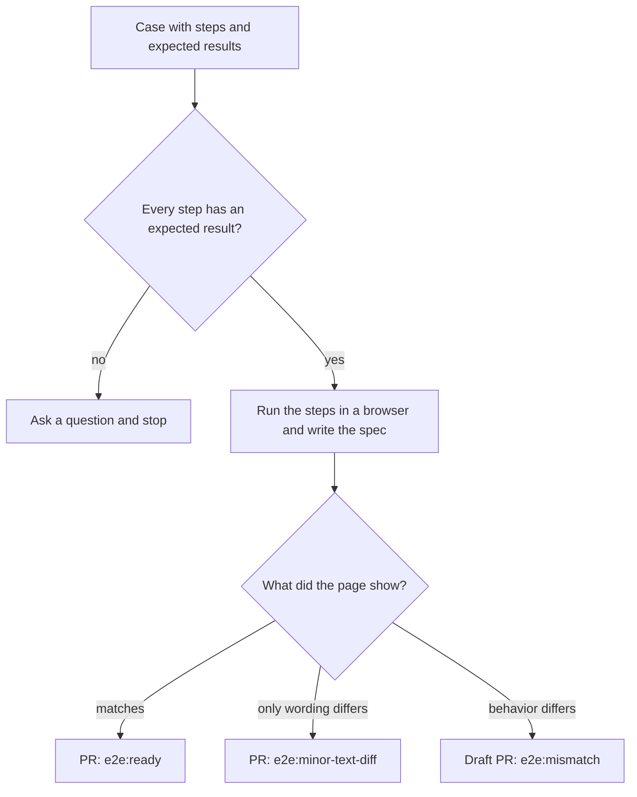

# Cabana: try e2e-qa-pilot in 5 minutes

Cabana is a small booking site with mock data. You send one line in chat. The assistant checks that your test case is clear, drives a real browser, writes a Playwright spec, and opens a pull request with the result and screenshots.

Each of the four cases below ends differently. Together they show what you get, and what you do not pay for.

| # | You send | You get |
|---|----------|---------|
| 1 | `Review cases/ready.md ...` | A pull request labeled `e2e:ready`. Every step matches. [Pull request](https://github.com/bogdanOwner/e2e-qa-pilot/pull/3) |
| 2 | `Review cases/wording.md ...` | A pull request labeled `e2e:minor-text-diff`. The behavior works and one sentence differs. [Pull request](https://github.com/bogdanOwner/e2e-qa-pilot/pull/4) |
| 3 | `Review cases/mismatch.md ...` | A draft pull request labeled `e2e:mismatch`. It names the failed step and shows the bug on screen. This run uses [`pr_mode: create_pr_for_review`](.e2e-qa-pilot/settings.md#L7). Set `ask_before_pr` there if you do not want a draft. [Pull request](https://github.com/bogdanOwner/e2e-qa-pilot/pull/5) |
| 4 | `Review cases/ambiguous.md ...` | No spec and no pull request. The assistant asks what should be visible after each step. The reply is quoted below. |

## Quick start

1. Start the site (from a clone of this repository, in `examples/boutique-cabin`):

   ```bash
   npm install
   npx playwright install chromium
   npm start
   ```

   The site runs at `http://127.0.0.1:4173`.

2. Connect your editor. Use one of these, then reload the window (Cursor) or restart the app (Claude Code), and **open a new chat**. A chat that was open before the reload does not have the server, so the line looks like it does nothing.

   ```bash
   npm run init:cursor    # writes .cursor/skills/ and .cursor/mcp.json
   npm run init:claude    # writes .claude/skills/ and .mcp.json
   ```

3. Send one line from a case below.

You only send the line. The assistant reviews the case and implements it when it is ready. The case text is in `cases/`, so you do not paste it.

## Case 1: everything matches

```text
Review cases/ready.md with e2e-qa-pilot and implement it if it is ready.
```

The guest searches 4 to 5 Aug 2026, reserves Chalet 4 at 497 EUR, fills the guest form, and confirms. Every expected result in the case is on the page.

**Result**: `e2e:ready`, 3 of 3 steps passed, no assertion was edited. [See the pull request](https://github.com/bogdanOwner/e2e-qa-pilot/pull/3). This run used Grok 4.7, a small and inexpensive model. Results vary by model.

<details>
<summary>Case text: <code>cases/ready.md</code></summary>

```text
Title: Book Chalet 4 at Cabana
Preconditions: the guest is on the Cabana page.
1. Set check-in to 4 Aug 2026 and check-out to 5 Aug 2026, then click Search.
   Expected: Chalet 4 is listed at 497 EUR, with 15% off and free cancellation. Chalet 1 is not available for the selected dates.
2. Press Increase quantity on the Chalet 4 rate priced at 497 EUR, then click Reserve Now.
   Expected: the selection shows Chalet 4 and a total of 497 EUR, and the guest form opens on the confirm page.
3. Enter First Name "Ana", Last Name "Pop", and Email Address "ana.pop@example.com", accept the terms, and click Confirm Booking.
   Expected: the confirmation says "Your request was successfully sent." and booking reference CAB-1042 is shown.
```

</details>

## Case 2: one sentence differs

```text
Review cases/wording.md with e2e-qa-pilot and implement it if it is ready.
```

This case is the same as Case 1, except that step 3 expects "Your request was **has been** successfully sent." The page says "Your request was successfully sent."

A small wording difference does not stop the run. The assistant still tests the whole flow and opens a pull request. The pull request shows the case sentence next to the screen sentence, so a person decides whether to merge or to fix the text. The exact sentence is never reported as a pass, and the assertion is not edited to make it green. The skill tests function, not copy.

**Result**: `e2e:minor-text-diff`, 2 of 3 steps passed. Step 3 quotes the case sentence next to the screen sentence. No assertion was edited. [See the pull request](https://github.com/bogdanOwner/e2e-qa-pilot/pull/4).

<details>
<summary>Case text: <code>cases/wording.md</code></summary>

```text
Title: Book Chalet 4 with the case confirmation sentence
Preconditions: the guest is on the Cabana page.
1. Set check-in to 4 Aug 2026 and check-out to 5 Aug 2026, then click Search.
   Expected: Chalet 4 is listed at 497 EUR, with 15% off and free cancellation. Chalet 1 is not available for the selected dates.
2. Press Increase quantity on the Chalet 4 rate priced at 497 EUR, then click Reserve Now.
   Expected: the selection shows Chalet 4 and a total of 497 EUR, and the guest form opens on the confirm page.
3. Enter First Name "Ana", Last Name "Pop", and Email Address "ana.pop@example.com", accept the terms, and click Confirm Booking.
   Expected: the confirmation says "Your request was has been successfully sent." and a booking reference is shown.
```

</details>

## Case 3: a real bug in the middle of the flow

```text
Review cases/mismatch.md with e2e-qa-pilot and implement it if it is ready.
```

The site has one deliberate defect. In the Guests picker, add a child and choose an age. The age is not saved, so the red **Select age** label stays after you click Done, and the picker does not close. The case is correct. The product is wrong.

The run fails at step 1. Steps 2 and 3 never run, so no time is spent on them. This example uses [`pr_mode: create_pr_for_review`](.e2e-qa-pilot/settings.md#L7), so the assistant still opens a draft pull request with the red `e2e:mismatch` label. Set `ask_before_pr` on that line if you do not want a draft in this case. The pull request shows the failed step, what was expected, what the screen showed, and a screenshot of the red label. A failed assertion is a finding for a person to judge, not an automatic verdict.

**Result**: draft `e2e:mismatch`. Step 1 failed: the Guests picker stayed open and the red "Select age" label was still visible. Steps 2 and 3 did not run. [See the pull request](https://github.com/bogdanOwner/e2e-qa-pilot/pull/5).

<details>
<summary>Case text: <code>cases/mismatch.md</code></summary>

```text
Title: Book Chalet 4 for a guest with a child
Preconditions: the guest is on the Cabana page.
1. Open the Guests picker, increase Children to 1, choose age 5 for the child, and click Done.
   Expected: the Guests picker closes, the guests summary shows 1 child, and no "Select age" error is visible.
2. Set check-in to 4 Aug 2026 and check-out to 5 Aug 2026, then click Search.
   Expected: Chalet 4 is listed at 497 EUR, with 15% off and free cancellation.
3. Press Increase quantity on the Chalet 4 rate priced at 497 EUR, then click Reserve Now.
   Expected: the selection shows Chalet 4 and a total of 497 EUR, and the guest form opens on the confirm page.
```

</details>

## Case 4: no expected result, so no spend

```text
Review cases/ambiguous.md with e2e-qa-pilot and implement it if it is ready.
```

The steps say what to do, but not what should happen. The assistant does not guess an expected result and does not start a spec. It asks what should be visible after each step. Nothing is run in the browser, so no tokens go into a test nobody can judge.

**Result**: a question in chat. No spec and no pull request.

The assistant replied:

```text
Book a chalet is not ready to automate. Each step says what to do and leaves out what should be visible, so there is nothing to assert yet.

Step 1: "Set check-in to 4 Aug 2026 and check-out to 5 Aug 2026, then click Search." This step has no expected result. What should be visible after Search?

Step 2: "Press Increase quantity on a Chalet 4 rate, then click Reserve Now." This step has no expected result. What should be visible after Reserve Now?

Step 3: "On the confirm page, enter the guest details, accept the terms, and click Confirm Booking." This step has no expected result. What should be visible after Confirm Booking?
```

<details>
<summary>Case text: <code>cases/ambiguous.md</code></summary>

```text
Title: Book a chalet
Preconditions: the guest is on the Cabana page.
1. Set check-in to 4 Aug 2026 and check-out to 5 Aug 2026, then click Search.
2. Press Increase quantity on a Chalet 4 rate, then click Reserve Now.
3. On the confirm page, enter the guest details, accept the terms, and click Confirm Booking.
```

</details>

## How the outcome is chosen



A person reviews every pull request. Nothing is merged automatically.

## Notes

- This is an example site with mock data. Confirm Booking sends no request. After the required fields are filled, it waits about 2 seconds, then shows `Your request was successfully sent.` and booking reference `CAB-1042`.
- The site is a build of the `boutique-cabin` template. The built files in `_astro` are committed so you do not need to build. Normally they would not be committed.
- The defect in Case 3 is deliberate. `npm run build:site` re-applies it through `scripts/build-from-template.mjs`.
- `npm test` checks the pages stored in `html/` and does not ask an assistant to review a case. `npm run build:html` rewrites those files from the live site. The four cases do not need either command.
- The spec title in `tests/book-chalet.spec.mjs` is different from the Case 1 title, so the duplicate check does not treat them as the same test.
