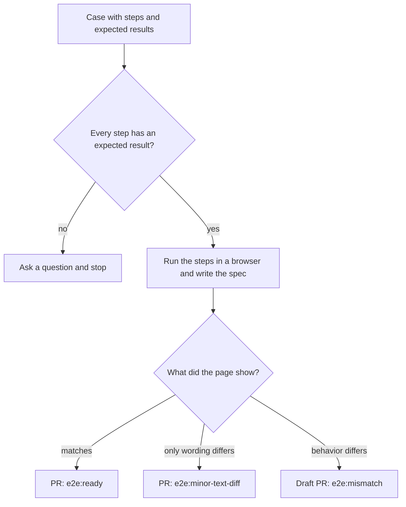

# Cabana: try e2e-qa-pilot in 5 minutes

Worked example for [e2e-qa-pilot](../../README.md).

**Cabana** is a small demo booking site that lives in this folder. It is a prebuilt Astro site with mock data, and `npm start` serves it on your machine at `http://127.0.0.1:4173`. Nothing is booked and nothing is sent anywhere. You run test cases against it to see what e2e-qa-pilot does.

You send one line in chat. The assistant checks that your test case is clear, drives a real browser, writes a Playwright spec, and opens a pull request with the result and screenshots.

Each of the four cases below ends differently. Together they show what you get, and what you do not pay for.

| You send | You get | You do |
|----------|---------|--------|
| [Case 1](#case-1-everything-matches): every step matches | <br>Behavior and screenshots match. [PR #3](https://github.com/bogdanOwner/e2e-qa-pilot/pull/3) | Check the screenshots, then merge |
| [Case 2](#case-2-one-sentence-differs): one sentence is off | <br>The flow works. The case sentence is shown next to the screen sentence. [PR #4](https://github.com/bogdanOwner/e2e-qa-pilot/pull/4) | Decide: fix the copy or the case |
| [Case 3](#case-3-a-real-bug-in-the-middle-of-the-flow): the site has a bug | <br>Draft. The failed step, what was expected, and the screen. [PR #5](https://github.com/bogdanOwner/e2e-qa-pilot/pull/5) | Judge the finding. It is not an automatic verdict |
| [Case 4](#case-4-no-expected-result-so-no-spend): no expected results | No spec and no pull request. The assistant asks what should be visible | Answer the question |

## Quick start

You do not need your own project. Everything runs inside a fork of this repository, against the Cabana site on your machine.

### Before you start

- **A GitHub account, signed in through the [`gh` CLI](https://cli.github.com/)** (`gh auth login`). Each run ends in a pull request on your fork, and the assistant uses `gh` to open it and add the label. Without it, you still get the spec and screenshots locally, but no pull request.
- Node.js 22 or later
- git
- Cursor or Claude Code

Two ways, same result:

- **Option 1: Let your agent set it up.** One prompt, one chat. The easiest way.
- **Option 2: Set it up step by step.** You run each command yourself and see what happens at every step.

Both end at [After setup](#after-setup).

### Option 1: Let your agent set it up

Open Cursor or Claude Code in an empty folder and paste this prompt:

```text
Set up the Cabana demo of e2e-qa-pilot:
1. Run gh repo fork bogdanOwner/e2e-qa-pilot --clone, then inside
   the e2e-qa-pilot folder run gh repo set-default <my GitHub user>/e2e-qa-pilot.
   If gh is missing or not signed in, stop and tell me how to fix it.
2. In e2e-qa-pilot/examples/boutique-cabin, run npm run setup:claude
   (npm run setup:cursor in Cursor) and show me its check.
3. Do not start the site. Tell me the steps in "After setup" of that folder's README.md.
```

Here is everything it runs. All of it is plain code you can read before you paste the prompt.

| Step | What runs | What it does | Read it |
|------|-----------|--------------|---------|
| 1 | `gh repo fork --clone`, `gh repo set-default` | Forks the repository to your account, clones the fork, and points `gh` at it, so pull requests go to your fork and not to the upstream repository | [gh repo fork](https://cli.github.com/manual/gh_repo_fork) |
| 2 | `npm run setup:claude` or `npm run setup:cursor` | `npm install`, `npx playwright install chromium`, then `init` for your editor. `init` prints a check of Node, git, Playwright, and `gh`, and writes the skills and MCP entry. These files are ignored by git | [package.json](package.json), [src/init.mjs](https://github.com/bogdanOwner/e2e-qa-pilot/blob/main/src/init.mjs) |
| 3 | Nothing | The agent does not start the site. You start it yourself in [After setup](#after-setup) | |

### Option 2: Set it up step by step

1. [Fork this repository](https://github.com/bogdanOwner/e2e-qa-pilot/fork) and clone your fork. Use a fork, not a plain clone: the assistant pushes a branch and opens the pull request there. Point `gh` at your fork so pull requests do not go to the upstream repository:

   ```bash
   git clone https://github.com/<you>/e2e-qa-pilot.git
   cd e2e-qa-pilot
   gh repo set-default <you>/e2e-qa-pilot
   ```

2. Install the Cabana site and connect your editor, in `examples/boutique-cabin`. Run one of these:

   ```bash
   cd examples/boutique-cabin
   npm run setup:claude    # writes .claude/skills/ and .mcp.json
   npm run setup:cursor    # writes .cursor/skills/ and .cursor/mcp.json
   ```

   Each one runs `npm install`, `npx playwright install chromium`, and `npm run init:claude` or `npm run init:cursor`. You can run those three yourself instead. The files it writes are ignored by git, so you do not commit anything.

3. Continue with [After setup](#after-setup).

### After setup

1. **Start the site.** In a terminal in `examples/boutique-cabin`, run `npm start` and keep it open. The site runs at `http://127.0.0.1:4173` and must be running while a case runs.
2. **Open the editor in `examples/boutique-cabin`** (not the repository root), reload the window (Cursor) or restart the app (Claude Code), and **open a new chat**. A chat that was open before the reload does not have the e2e-qa-pilot tools, so the line looks like it does nothing.
3. **Send Case 1:**

   ```text
   Review cases/ready.md with e2e-qa-pilot and implement it if it is ready.
   ```

   Try [Cases 2 to 4](#case-2-one-sentence-differs) the same way.

### Send a case

You only send one line. The assistant reviews the case and implements it when it is ready. The case text is in `cases/`, so you do not paste it.

**Write your own case.** Copy `cases/ready.md` to a new file in `cases/`, change the title, steps, and expected results, and send the same line with the new file name. Every step needs an expected result, or the assistant asks for one.

## Case 1: everything matches

```text
Review cases/ready.md with e2e-qa-pilot and implement it if it is ready.
```

The guest searches 4 to 5 Aug 2026, reserves Chalet 4 at 497 EUR, fills the guest form, and confirms. Every expected result in the case is on the page.

**Result**: `e2e:ready`, 3 of 3 steps passed, no assertion was edited. [See the pull request](https://github.com/bogdanOwner/e2e-qa-pilot/pull/3). This run used Grok 4.7, a small and inexpensive model. Results vary by model.

**In the pull request**

- Case input: `cases/ready.md`, three steps, each with an expected result.
- Generated spec: `tests/book-chalet-4-at-cabana.spec.mjs`, with Gherkin in `specs/book-chalet-4-at-cabana.md`.
- Screenshot evidence: 7 images across the 3 steps, ending on the confirmation and booking reference `CAB-1042`.
- Reviewer checks: the screenshots show what the Steps table says, including the filled guest form and the checked terms box, and the test data (dates, name, email) is acceptable.

<details>
<summary>Case text: <code>cases/ready.md</code></summary>

```text
Title: Book Chalet 4 at Cabana
Preconditions: the guest is on the Cabana page.
1. Set check-in to 4 Aug 2026 and check-out to 5 Aug 2026, then click Search.
   Expected: Chalet 4 is listed at 497 EUR, with 15% off and free cancellation. Chalet 1 is not available for the selected dates.
2. Press Increase quantity on the Chalet 4 rate priced at 497 EUR, then click Reserve Now.
   Expected: the selection shows Chalet 4 and a total of 497 EUR, and the guest form opens on the confirm page.
3. Enter First Name "Ana", Last Name "Pop", and Email Address "ana.pop@example.com", accept the terms, and click Confirm Booking.
   Expected: the confirmation says "Your request was successfully sent." and booking reference CAB-1042 is shown.
```

</details>

## Case 2: one sentence differs

```text
Review cases/wording.md with e2e-qa-pilot and implement it if it is ready.
```

This case is the same as Case 1, except that step 3 expects "Your request was **has been** successfully sent." The page says "Your request was successfully sent."

A small wording difference does not stop the run. The assistant still tests the whole flow and opens a pull request. The pull request shows the case sentence next to the screen sentence, so a person decides whether to merge or to fix the text. The exact sentence is never reported as a pass, and the assertion is not edited to make it green. The skill tests function, not copy.

**Result**: `e2e:minor-text-diff`, 2 of 3 steps passed. Step 3 quotes the case sentence next to the screen sentence. No assertion was edited. [See the pull request](https://github.com/bogdanOwner/e2e-qa-pilot/pull/4).

**In the pull request**

- Case input: `cases/wording.md`, the same as Case 1 except for the sentence in step 3.
- Generated spec: `tests/book-chalet-4-with-the-case-confirmation-sentence.spec.mjs`.
- Screenshot evidence: 6 images across the 3 steps. Step 3 has the filled form and the confirmation, and the Steps table quotes the screen sentence.
- Reviewer checks: the screenshots show what the Steps table says, the test data is acceptable, and the text difference is understood. Decide whether the copy or the case should change.

<details>
<summary>Case text: <code>cases/wording.md</code></summary>

```text
Title: Book Chalet 4 with the case confirmation sentence
Preconditions: the guest is on the Cabana page.
1. Set check-in to 4 Aug 2026 and check-out to 5 Aug 2026, then click Search.
   Expected: Chalet 4 is listed at 497 EUR, with 15% off and free cancellation. Chalet 1 is not available for the selected dates.
2. Press Increase quantity on the Chalet 4 rate priced at 497 EUR, then click Reserve Now.
   Expected: the selection shows Chalet 4 and a total of 497 EUR, and the guest form opens on the confirm page.
3. Enter First Name "Ana", Last Name "Pop", and Email Address "ana.pop@example.com", accept the terms, and click Confirm Booking.
   Expected: the confirmation says "Your request was has been successfully sent." and a booking reference is shown.
```

</details>

## Case 3: a real bug in the middle of the flow

```text
Review cases/mismatch.md with e2e-qa-pilot and implement it if it is ready.
```

The site has one deliberate defect. In the Guests picker, add a child and choose an age. The age is not saved, so the red **Select age** label stays after you click Done, and the picker does not close. The case is correct. The product is wrong.

The run fails at step 1. Steps 2 and 3 never run, so no time is spent on them. This example uses [`pr_mode: create_pr_for_review`](.e2e-qa-pilot/settings.md), so the assistant still opens a draft pull request with the red `e2e:mismatch` label. Set `ask_before_pr` on that line if you do not want a draft in this case. The pull request shows the failed step, what was expected, what the screen showed, and a screenshot of the red label. A failed assertion is a finding for a person to judge, not an automatic verdict.

**Result**: draft `e2e:mismatch`. Step 1 failed: the Guests picker stayed open and the red "Select age" label was still visible. Steps 2 and 3 did not run. [See the pull request](https://github.com/bogdanOwner/e2e-qa-pilot/pull/5).

**In the pull request**

- Case input: `cases/mismatch.md`, three steps with expected results. Step 1 describes a Guests picker that closes after Done.
- Generated spec: `tests/book-chalet-4-for-a-guest-with-a-child.spec.mjs`. The expected result was not rewritten to make it pass.
- Screenshot evidence: 1 image of the open Guests picker with the red "Select age" label. Steps 2 and 3 did not run, so they have no screenshot.
- Reviewer checks: the screenshot shows what the Steps table says, the test data is acceptable, and the step 1 mismatch is understood. Decide whether this is a product bug or a wrong case. The pull request calls it a finding, not a confirmed regression.

<details>
<summary>Case text: <code>cases/mismatch.md</code></summary>

```text
Title: Book Chalet 4 for a guest with a child
Preconditions: the guest is on the Cabana page.
1. Open the Guests picker, increase Children to 1, choose age 5 for the child, and click Done.
   Expected: the Guests picker closes, the guests summary shows 1 child, and no "Select age" error is visible.
2. Set check-in to 4 Aug 2026 and check-out to 5 Aug 2026, then click Search.
   Expected: Chalet 4 is listed at 497 EUR, with 15% off and free cancellation.
3. Press Increase quantity on the Chalet 4 rate priced at 497 EUR, then click Reserve Now.
   Expected: the selection shows Chalet 4 and a total of 497 EUR, and the guest form opens on the confirm page.
```

</details>

## Case 4: no expected result, so no spend

```text
Review cases/ambiguous.md with e2e-qa-pilot and implement it if it is ready.
```

The steps say what to do, but not what should happen. The assistant does not guess an expected result and does not start a spec. It asks what should be visible after each step. Nothing is run in the browser, so no tokens go into a test nobody can judge.

**Result**: a question in chat. No spec and no pull request.

The assistant replied:

```text
Book a chalet is not ready to automate. Each step says what to do and leaves out what should be visible, so there is nothing to assert yet.

Step 1: "Set check-in to 4 Aug 2026 and check-out to 5 Aug 2026, then click Search." This step has no expected result. What should be visible after Search?

Step 2: "Press Increase quantity on a Chalet 4 rate, then click Reserve Now." This step has no expected result. What should be visible after Reserve Now?

Step 3: "On the confirm page, enter the guest details, accept the terms, and click Confirm Booking." This step has no expected result. What should be visible after Confirm Booking?
```

<details>
<summary>Case text: <code>cases/ambiguous.md</code></summary>

```text
Title: Book a chalet
Preconditions: the guest is on the Cabana page.
1. Set check-in to 4 Aug 2026 and check-out to 5 Aug 2026, then click Search.
2. Press Increase quantity on a Chalet 4 rate, then click Reserve Now.
3. On the confirm page, enter the guest details, accept the terms, and click Confirm Booking.
```

</details>

## How to read a pull request

Every pull request has the same parts. Check them top to bottom:

| Part | What to check |
|------|---------------|
| **Summary line** | The label, steps passed, and `assertion_edits`. It should be 0: the agent did not change an expected result to make the test pass |
| **Case and test data** | The values the test typed are ones you accept |
| **Steps table** | For each step: expected, actual, verdict |
| **Screenshots** | Each one shows its own step, not a repeat of an earlier screen |
| **Files changed** | The spec in `tests/`, the Gherkin in `specs/`, the page contract in `pages/` |
| **Review checklist** | Tick the items the agent left for you |

A green run proves only that the spec's assertions passed. The steps table and the screenshots show whether the spec covers the case. A label is a review outcome, not an approval.

## How the outcome is chosen



A person reviews every pull request. Nothing is merged automatically.

## Notes

- This is an example site with mock data. Confirm Booking sends no request. After the required fields are filled, it waits about 2 seconds, then shows `Your request was successfully sent.` and booking reference `CAB-1042`.
- The site is a build of the `boutique-cabin` template. The built files in `_astro` are committed so you do not need to build. Normally they would not be committed.
- The defect in Case 3 is deliberate. `npm run build:site` re-applies it through `scripts/build-from-template.mjs`.
- `npm test` checks the pages stored in `html/` and does not ask an assistant to review a case. `npm run build:html` rewrites those files from the live site. The four cases do not need either command.
- The spec title in `tests/book-chalet.spec.mjs` is different from the Case 1 title, so the duplicate check does not treat them as the same test.
