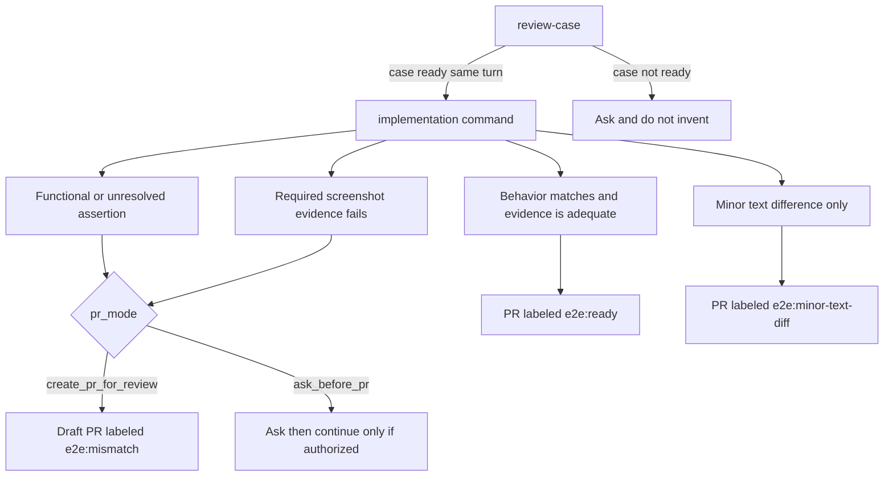

# Create e2e

Author end-to-end coverage from one case. A case id or pasted case text, plus `.e2e-qa-pilot/settings.md` and `.e2e-qa-pilot/project.md`, are the inputs. [review-case](commands/review-case/SKILL.md) is the only router. A case tool is required only for a case id.

`figma: off` in the settings file ignores a Figma URL and sends the case to [add-from-steps](commands/add-from-steps/SKILL.md). A missing `pr_mode` means `create_pr_for_review`. The server does not parse or enforce it. Apply one label: `e2e:ready`, `e2e:minor-text-diff`, or draft `e2e:mismatch`. Nothing is auto-merged. Assertion findings and screenshot findings stay separate.

| Command | When |
|---------|------|
| [review-case](commands/review-case/SKILL.md) | First. Ready checks, one question per hole, update that same case when it came from an id, then route |
| [add-from-design](commands/add-from-design/SKILL.md) | The case has a `figma.com` URL and `figma: on` |
| [add-from-steps](commands/add-from-steps/SKILL.md) | No Figma URL, or `figma: off` |
| [setup-project](commands/setup-project/SKILL.md) | Once per project, and when its setup changes. Fills in `.e2e-qa-pilot/project.md`. Takes no case |

Shared rules: [ready-rules.md](commands/shared/ready-rules.md), [pr-evidence.md](commands/shared/pr-evidence.md), [project-config.md](commands/shared/project-config.md) (how `.e2e-qa-pilot/project.md` is read), and [workflow.md](commands/shared/workflow.md) (case title, duplicate check, branch name, git steps, where files live).

Install with `npx e2e-qa-pilot init` in your project, once the package is published to npm. What to ask, the input contract, and the tool results are in `mcp.md` in the e2e-qa-pilot package and repository.
