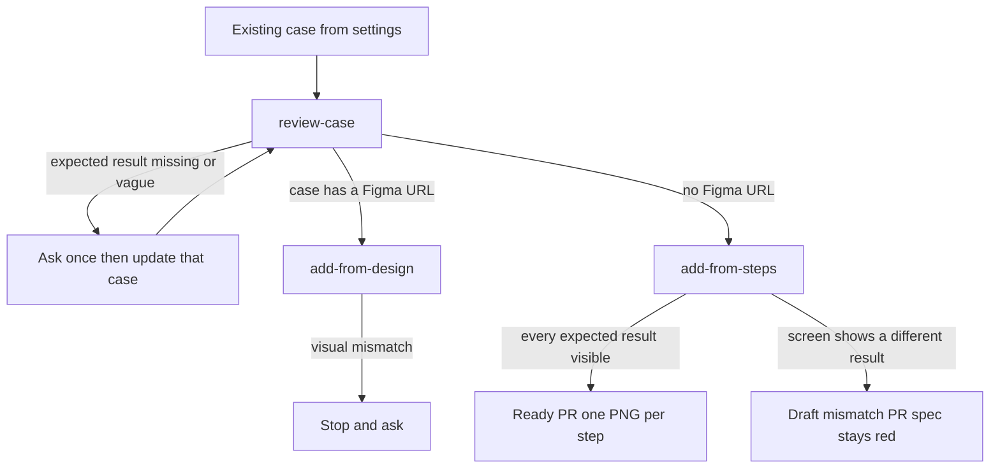

# Create e2e

Author end-to-end coverage from one existing case. The case id and `.e2e-qa-pilot/settings.md` are the inputs. [review-case](commands/review-case/SKILL.md) is the only router.

`figma: off` in the settings file ignores a Figma URL and sends the case to [add-from-steps](commands/add-from-steps/SKILL.md).

| Command | When |
|---------|------|
| [review-case](commands/review-case/SKILL.md) | First. Ready checks, one question per hole, update that same case, then route |
| [add-from-design](commands/add-from-design/SKILL.md) | The case has a `figma.com` URL and `figma: on` |
| [add-from-steps](commands/add-from-steps/SKILL.md) | No Figma URL, or `figma: off` |

Shared rules: [ready-rules.md](commands/shared/ready-rules.md) and [pr-evidence.md](commands/shared/pr-evidence.md).

Install with `npx e2e-qa-pilot init` in your project. What to ask and the three tool results are in `mcp.md` in the e2e-qa-pilot repository.
